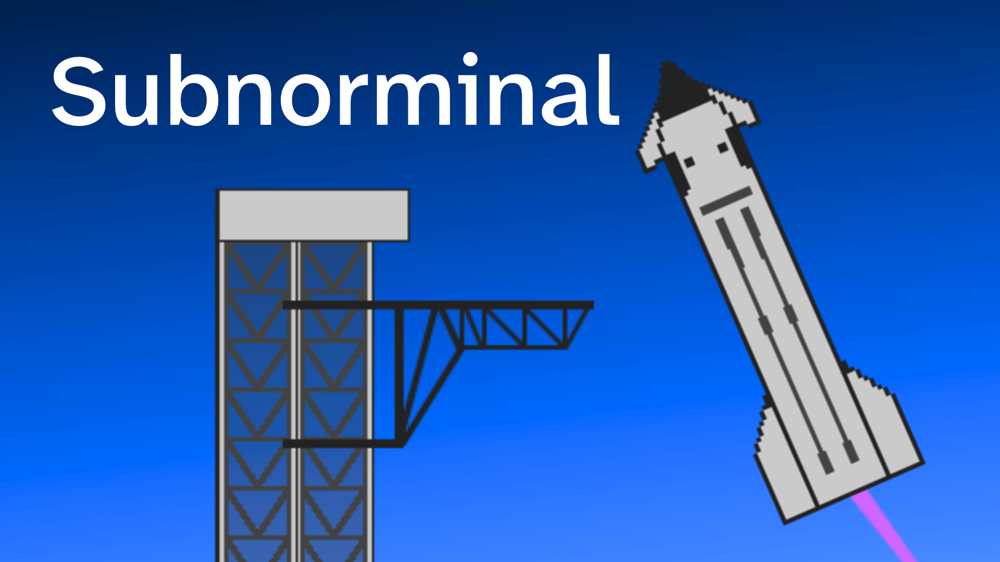
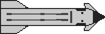

# Subnorminal
Inspired by the journey of humanity to earn our place among the stars, we start with SpaceX's vision of rapidly reusable rockets, catching them like pencils falling from space, with chopsticks.

With realistic physics!

Find us on itch.io! https://cyb3rgeorge.itch.io/subnorminal

## Features & Mechanics
1. Propulsion system
2. Flight controls (throttle, pitch, engine selection)
3. Real-time telemetry
4. Propellant consumption (propellant has mass!)
5. Atmospheric drag along both the x- and y-axes
6. Dynamic air density based on altitude
7. Engine visuals and audio
8. Adjustable camera zoom

Apply your knowledge of physics and Starship to win!

### Norminal Catch Condition
Get caught by Mechazilla (the launch tower)'s chopstick arms with a speed no more than 10 m/s. Catch pins on Starship are slightly under the forward flaps, and the damping rails on Mechazilla are on top of the far end of the chopsticks, just like in real life!

### Notes
1. Rapid unscheduled disassemblies (RUDs) initially occur with the random probability of 64% per 5 seconds. When the number of subnorminal attempts increase, the probability of a RUD decreases, dropping to 0% at 10 subnorminal attempts.
2. The flaps on Starship does _not_ contribute to its hitbox.

### Common Mistake
To produce thrust,
1. at least one engine must be activated, 
2. throttle must be more than zero, and
3. propellant must be more than zero.

If all three conditions are _not_ met, no thrust will be produced.

## Controls
| Input | Function|
|-----|---------|
| z / = / . / scrollUp| zoom in |
| x / - / , / scrollDown| zoom out |

### Right-Handed Controls
| Input | Function|
|-----|---------|
| 1 | 1-engine burn |
| 2 | 2-engine burn |
| 3 | 3-engine burn |
| Q | Engine cutoff |
| arrowUp | Throttle up |
| arrowDown | Throttle down |
| arrowLeft | Pitch up |
| arrowRight | Pitch down |

### Left-Handed Controls
| Input | Function|
|-----|---------|
| 9 | 1-engine burn |
| 8 | 2-engine burn |
| 7 | 3-engine burn |
| 0 | Engine cutoff |
| W | Throttle up |
| S | Throttle down |
| A | Pitch up |
| D | Pitch down |

### One-Handed Controls
| Input | Function|
|-----|---------|
| 1 | 1-engine burn |
| 2 | 2-engine burn |
| 3 | 3-engine burn |
| Q | Engine cutoff |
| W | Throttle up |
| S | Throttle down |
| A | Pitch up |
| D| Pitch down |

## Attribution & Licenses
Credits to George's 48 hours of sleep deprivation (and further locking in after the hackathon). \
Assisted by Limeetha Sai, Isaac, and the Haven Penang team.

Music: Kevin MacLeod \
Sound: SpaceX \
Video: SpaceX 

<a href="https://github.com/cyb3rgeorge/subnorminal">Subnorminal</a> (c) 2026 by <a href="https://github.com/cyb3rgeorge">cyb3rgeorge</a> is licensed under the MIT License

The art for <a href="https://github.com/cyb3rgeorge/subnorminal">Subnorminal</a> (c) 2026 by <a href="https://github.com/cyb3rgeorge">cyb3rgeorge</a> and <a href="https://github.com/limeethasaias">Limeetha Sai</a> is licensed under <a href="https://creativecommons.org/licenses/by-nc/4.0/">CC BY-NC 4.0</a>

Atkinson Hyperlegible Next (c) 2020-2024 <a href="https://github.com/googlefonts/atkinson-hyperlegible-next">The Atkinson Hyperlegible Next Project Authors</a> is licensed under the <a href="https://openfontlicense.org/open-font-license-official-text/">SIL Open Font License, Version 1.1</a>

"Arcadia" Kevin MacLeod (incompetech.com)\
Licensed under <a href="https://creativecommons.org/licenses/by/4.0/">Creative Commons: By Attribution 4.0 License</a>
